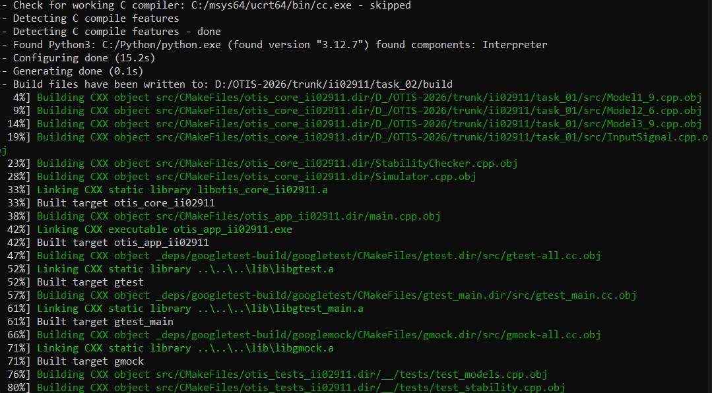
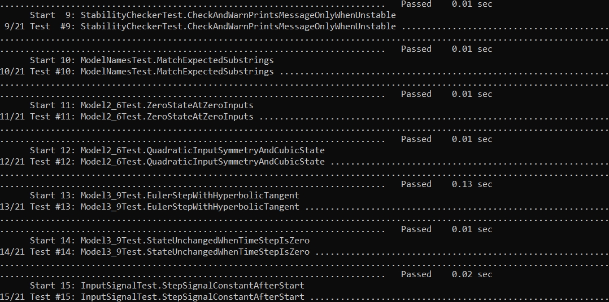
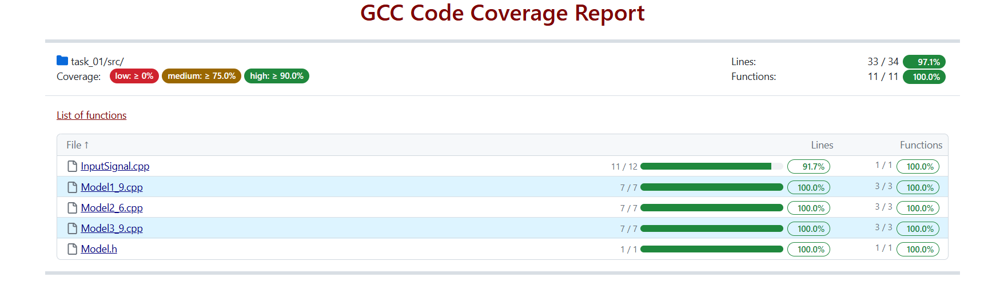
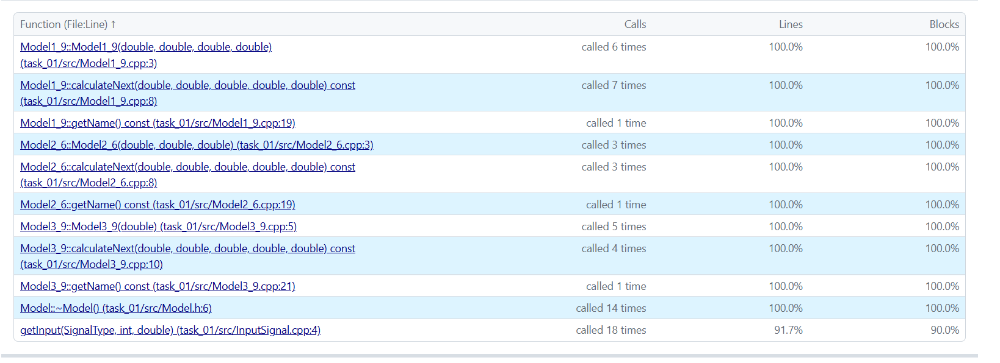

Министерство образования Республики Беларусь

Учреждение образования

«Брестский Государственный технический университет»

Кафедра ИИТ

    

Лабораторная работа №2

По дисциплине «Общая теория интеллектуальных систем»

Тема: «Модульное тестирование
»

   

Выполнил:

Студент 2 курса

Группы ИИ-29

Кондратчик Н.И.

Проверил:

Дворанинович Д. А.

   

Брест 2026

## Задание
Написать модульные тесты для программы, разработанной в лабораторной работе №1, предварительно расширив её математический и функциональный базис.

## Тестовое покрытие и результаты

* **Запуск:** Скрипт (`run_tests.bat`)
* **Количество модульных тестов:** 34
* **Количество пройденных тестов:** 33 / 34

## Запуск программы

## Время прохождения тестов в консоле 

### ВЫПОЛНЕНИЕ ТЕСТОВ:
---

## Скриншот HTML 

## Скриншот времени выполнения теста 

